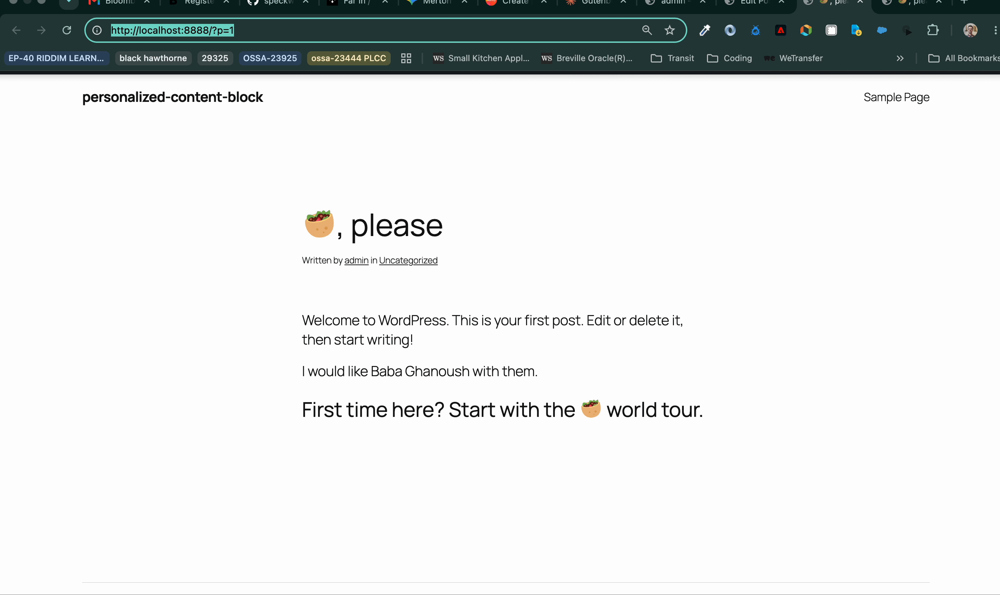

*One cached page, two experiences. No flicker, no layout shift.*
# Personalized Content Block

A Gutenberg block that shows its nested blocks to **new** or **returning** visitors. Authors add one block per audience; every variant ships in the page HTML, and the right one is revealed before first paint.

## Run it

```bash
npm install
npm run build
npx wp-env start      # needs Docker; WordPress at http://localhost:8888 (admin / password)
```

Activate **Personalized Content Block**, create a page, and add two blocks: one set to *New visitors*, one to *Returning visitors*. Visit the page, then open it in a new tab (or clear `sessionStorage`) to see the switch. To reset the "returning" flag, clear `localStorage.pc_seen`.

## Design decisions

| Decision | Why |
| --- | --- |
| Render all variants, choose in the browser | Page caches serve one HTML file to everyone, so PHP can't personalize per visitor. |
| Tiny blocking inline script in `<head>` sets `data-visitor` on `<html>` | Resolved before first paint, so no flicker and no layout shift. A deferred script would hurt CLS. |
| CSS hides the other variant (`display:none`) | No JS needed after classification, and hidden content leaves the accessibility tree. |
| Segment pinned in `sessionStorage` | A reload mid-session doesn't flip "new" to "returning". |
| Segment pushed to `dataLayer` | GA4 / GTM / Optimizely can segment on `visitor_segment`. |
| `useInnerBlocksProps` with a template | Authors get a sensible starting layout and can nest any blocks. |
| Static `save` | Cheap to render. Changing its markup later needs a `deprecated` entry. |

## Known trade-offs

- Crawlers see every variant. Fine for marketing copy, wrong for anything that must stay private.
- Both variants are downloaded, so keep heavy media out of the hidden one or lazy-load it.
- `localStorage` may need cookie-consent handling depending on jurisdiction and policy.
- Two segments only. Real segmentation (geo, campaign, logged-in) would add server-side or edge logic.

## Ideas to extend

1. Add a `deprecated` entry after changing `save`, and write a test for it.
2. Add a `campaign` audience driven by a UTM parameter.
3. Add a server-rendered variant (PHP `render`) for logged-in users, where caching is already bypassed.
4. Add Playwright tests for "first visit shows X, second visit shows Y".
